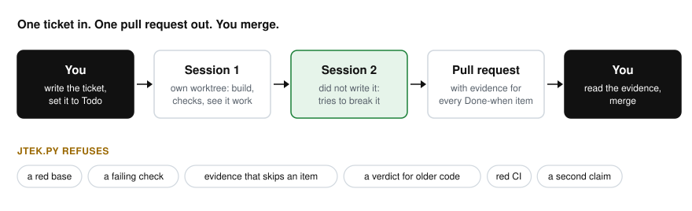

<h1 align="center">jtek</h1>

<p align="center">
  <em>One ticket in. One pull request out. You merge.</em>
</p>

<p align="center">
  
  
  
  
  
</p>

<p align="center">
  <picture>
    <source media="(prefers-color-scheme: dark)" srcset="assets/flow-dark.svg">
    
  </picture>
</p>

---

You know the pull request. Forty files. "All tests pass." The feature does not start.

An agent will tell you the work is done. jtek does not take its word. A ticket reaches Review only when the project's own checks pass on the current commit, a session that did not write the change has tried to break it, and every `Done when` item has a line that says what was run and seen, or why it was not run.

Then it stops. You read the evidence. You merge.

## What you get back

Every session ends with the same block, whether you started it by hand or a bot did.

```text
jtek-result
id: T-12
status: Review
outcome: review
waiting: -
checks: lint=pass types=pass test=pass verify=pass @1a2b3c4
verdict: PASS by reviewer @1a2b3c4
pr: https://github.com/you/app/pull/41
ci: pass
evidence: .git/jtek/work/T-12/evidence.md (3 seen, 0 not run, 3 of the seen cite a recorded run, clean-up rests on a recorded diff)
attention: -
branch: jtek/T-12
source: https://www.notion.so/...
note: the human reviews and merges; jtek never merges.
comment file: .git/jtek/work/T-12/board-comment.md
board: Status=Review; Waiting=; PR=https://github.com/you/app/pull/41; comment=result+evidence
```

Read `evidence` first, then `attention`, then the diff. `attention` names files that decide whether checks pass: a changed check script, CI config, a lockfile, `Makefile` or `package.json`, a deleted test, or an existing test that lost lines. It works from a list of known names. Add your project's own with `watch` in `jtek.json`.

## How it works

1. **You write a ticket** as a page on a Notion board, with `Goal` and `Done when`, and set it to Todo.
2. **A session takes it.** The agent reads the page with its Notion tool and runs `jtek.py start`. The script claims the ticket, creates a worktree, and runs the checks on the base first. A base that is already red is refused.
3. **It works in steps.** Understand, build, check, see it work, clean up, ship. Each step is one small skill, and `jt-work` keeps the order.
4. **The project's checks run.** They come from `jtek.json` on the base branch. An edit in the worktree cannot weaken them.
5. **A second session gives the verdict.** It did not write the change, and it reads only the ticket and the diff. A verdict belongs to the content of the change, so any edit, even of whitespace, needs a new one. So does a change you make to the ticket.
6. **A pull request opens** with the evidence as its body. The script prints a `board:` line, and the agent writes exactly that on the Notion page.
7. **You merge.** There is no merge command.

If the agent is stuck or has a question, it stops and puts the question on the page. You answer and set the ticket back to Todo.

`jtek.py` never talks to Notion. The agent reads and writes the board with its own Notion tool, and the script says what to write.

## The whole factory

<p align="center">
  <picture>
    <source media="(prefers-color-scheme: dark)" srcset="assets/factory-dark.svg">
    
  </picture>
</p>

| Loop | Who | What it does | What it never does |
|---|---|---|---|
| **Human in the loop** | You | Writes the ticket, sets Todo, answers questions, reads the evidence, merges | |
| **Outer loop** | You, a Claude Code session, or a bot | Reads the board, asks `jtek.py next` what each ticket needs, starts a session, asks again when it ends | Writes code, gives a verdict, sets Todo, merges |
| **Inner loop** | One agent session per ticket | Builds the change in its own worktree, passes the checks, sees it work, opens the pull request. A second session gives the verdict | Picks the next ticket, merges |

jtek is the inner loop, plus the one command the outer loop needs. Black boxes are yours. Green boxes run something real. Dashed lines are the ways back: a question for you, or a failed review.

## The prompt

The whole set is eleven skills and one Python script. Start with [`skills/jt-work/SKILL.md`](skills/jt-work/SKILL.md): it is the router, and the only skill that knows the order. The script is [`skills/jt-work/scripts/jtek.py`](skills/jt-work/scripts/jtek.py), standard library only. Two small files beside it, `launcher.py` and `doctor.py`, hold the commands that are not part of working a ticket.

It uses no other skill set.

## Install

**Any agent** (Claude Code, Cursor, Antigravity, Codex, ...) with [skills.sh](https://skills.sh/thitinan147/jtek-skill):

```bash
npx skills add thitinan147/jtek-skill
```

**Claude Code**, as two separate prompts:

```
/plugin marketplace add thitinan147/jtek-skill
```
```
/plugin install jtek@jtek-skill
```

Install the whole set. The script lives in `jt-work` and `jt-review`, so a step skill installed alone cannot run it.

Needs `git` 2.31 or later, Python 3.10 or later, and an agent with a Notion tool. With GitHub, you also need `gh`, signed in: the agent opens the pull request with it, and the script reads the pull request's state and CI result with it. With another forge, you name your own command for that in `jtek.json`.

## Set up

Three things, once. For every step with what you should see, from connecting Notion to the first merged ticket, follow **[GETTING-STARTED.md](GETTING-STARTED.md)**.

**1. The board.** Create one Notion database with the properties in [notion.md](skills/jt-work/references/notion.md): eleven of them, and the names and types must match. Then connect the Notion tool in your agent and give it access to that database. Notion's MCP server is set up in your agent's MCP settings; in Claude Code that is `/mcp`, then Notion.

Keep the database's link: it goes into `jtek.json` in the next step.

**2. The checks.** In each repository, ask the agent:

```text
Run jtek.py init in this repository.
```

The script is inside the installed `jt-work` skill, and the agent knows where that is. This writes `jtek.json`. Set `board` to the database's link and `name` to the name tickets use for this repository, fill in one command per check, delete the ones the project does not have, and commit the file on the base branch:

```json
{"board": "https://www.notion.so/...", "name": "web", "setup": "npm ci", "checks": {"lint": "npm run lint", "types": "npm run typecheck", "test": "npm test", "verify": "node scripts/verify.mjs"}}
```

A command is one program with arguments. Put a pipeline in a script. Ask the agent to run `jtek.py doctor`: it says what is still missing.

**3. The harness.** Run the `jt-harness` skill once per repository. It writes `.jtek/` (how to run and drive the real app, and a feature map) and proposes the `verify` check. Without it, a passing check only means the code compiles.

`jtek.json` and `.jtek/` are all jtek adds to a repository. Claims, logs, and results live under the git directory and are never committed. Details: [setup.md](skills/jt-work/references/setup.md).

## Fit it to your project

The rules are fixed. The numbers and names around them are yours, in `jtek.json`:

| Key | What it changes | Default |
|---|---|---|
| `checks`, `setup` | The commands that decide "passing", in any language or build system | none: you declare them |
| `max_failed_runs` | How many failed check runs end a session. Raise it for a model that often finds the cause on a later try | 3 |
| `pr_state` | The command that reads a pull request, for GitLab, Bitbucket, or another forge. [An example for GitLab](examples/pr-state-gitlab.py) | `gh`, for GitHub |
| `headings` | The names of the three ticket headings, in your team's language | `Goal`, `Done when`, `Out of scope` |
| `watch` | More files that the `attention:` line should name | a list of common names |
| `forge` | `false` when the remote is not a forge, so tickets end without a pull request | `true` |
| `name` | What tickets call this repository | the folder name |

Details: [setup.md](skills/jt-work/references/setup.md).

**What jtek does not decide.** How the agent writes the code, which tools it uses, how it splits the work inside a ticket, and how good the model is. The script looks at results: the checks, the evidence, the verdict. A better model reaches them sooner, and nothing here is in its way.

**Which agent.** The same tickets were worked end to end on Claude Code, on Cursor's command-line agent (its own pick of model, with a Grok reviewer), and on Antigravity's (Gemini). All three read the skill files, recorded their runs with `jtek.py run`, started their own reviewer, and listed the board lines they could not write when they had no Notion tool.

**Which model.** Use the strongest model you have for `jt-work`, and above all for `jt-review`. On the same tickets, Sonnet and Haiku got the code right, but each wrote a `seen:` line that said more than it had run and skipped part of a step; the strongest model did that once in nine rounds. The script holds what a machine can check, and a run recorded with `jtek.py run` shows what a `seen:` line rests on. Whether the line matches the run is still for the reviewer to read, so a smaller worker needs a reviewer on the strongest model.

**What still assumes today's agents.** Tickets small enough for one pull request, one ticket at a time in a session, and stopping to ask when a ticket is unclear. The step skills also teach a method for debugging and building. Run the [evals](evals/README.md) when you change models, and cut the text that no longer raises the score.

**Where it does not fit yet.**

- A project whose real behaviour cannot be run from a command line, such as some mobile apps, games, and hardware. The checks still work. The `verify` step has little to run.
- Windows. Nothing has been tested there.
- A project without git, or one where a second worktree cannot be set up by a command.

## Commands

| You want to | Do this |
|---|---|
| Add a ticket | Write a page on the board with `Goal` and `Done when`, and set Status to Todo |
| Work a ticket | `/jt-work T-12`, or `/jt-work <Notion page link>` |
| Work a few small, related tickets | `/jt-work T-12 T-13 T-14` |
| Give the verdict a ticket needs | `/jt-review T-12` in a fresh session |
| Answer a question, or ask for a fix | Write on the page, set Status to Todo, then `/jt-work T-12` |
| Give a ticket back, or clean up a start that was interrupted | Ask the agent to run `jtek.py release T-12`. A branch that holds work is kept, and the next start goes on from it |
| Let something else start the sessions | [starting-sessions.md](skills/jt-work/references/starting-sessions.md) |

Something has to choose the next ticket and start the session. That is you, a Claude Code session, or a bot. All three ask the same question, `jtek.py next`, and do what it answers: `work`, `review`, or nothing.

## Templates

Three files carry a ticket from your head to your review. Each has a form, and each form is short.

**The ticket**, which you write. Set it as the default template of the Notion database, and every new page starts like this:

```markdown
## Goal
A user can add a phone number on the profile page, so that sales can call back.

## Done when
- PATCH /me with a 10-digit `phone` returns 200, and GET /me returns the same number
- a `phone` that is not 10 digits returns 422 and names the field
- the profile page shows the saved number after a reload

## Out of scope
- the response for every other field of /me stays the same, byte for byte
- no SMS confirmation yet
```

Every `Done when` item names an input and a result, so someone can see it work. `Out of scope` names behaviour that must not change.

**The evidence**, which the agent writes and you read before the diff. One numbered line per `Done when` item and a `clean-up:` line, and the script refuses a file that lacks either:

```text
The profile now stores a phone number. PATCH /me validates it with the existing validator, and the page shows it.

1. seen: PATCH /me with phone "0812345678" on the local server -> 200, then GET /me returns "0812345678" (runs 1 and 2)
2. seen: PATCH /me with phone "12ab" -> 422 {"field":"phone","error":"must be 10 digits"} (run 3)
3. not run: no browser on this machine, so the profile page was not opened. The API returns the value

Notes:
- clean-up: removed a console.log left in the handler (run 4)
- reused the validator in lib/validate.ts
- the number is stored as text, because a leading 0 is lost in a number
```

`seen:` means it was run and looked at, and `(run 3)` names the run `jtek.py run` recorded, which a reader can open. `not run:` is an honest answer, and it tells you what to check by hand. Here that is item 3.

**The review notes**, which the second session writes. A finding has steps that fail when anyone runs them:

```markdown
Findings:
- reproduces: PATCH /me with an empty phone returns 500, not 422
  steps: start the server as `.jtek/verify.md` says, then PATCH /me with phone ""
  expected: 422, by Done when item 2

Notes:
- did not reproduce: a phone with spaces. Tried "081 234 5678", got 422 as it should
- the new tests cover items 1 and 2. Nothing tests item 3
- I broke the length check on purpose, and the new test failed, so the test is real
```

<details>
<summary><strong>The repository's own files:</strong> <code>jtek.json</code>, <code>.jtek/verify.md</code>, a feature file, and <code>.jtek/rules.md</code></summary>

`jtek.json`, on the base branch. One command per check, read from there and never from a ticket's worktree:

```json
{"board": "https://www.notion.so/...", "name": "web", "setup": "npm ci", "checks": {"lint": "npm run lint", "types": "npm run typecheck", "test": "npm test", "verify": "node scripts/verify.mjs"}}
```

`.jtek/verify.md`, written by `jt-harness`. How an agent starts the real app and checks it:

```markdown
## Launch
- Install: `npm ci`
- Port: 3000 plus the ticket's number, so two worktrees never share one. Ticket `T-12` uses 3012.
- Start: `npm run dev -- --port <port>`
- Ready when: `node scripts/ready.mjs <port>` exits 0. A listening port is not ready yet.

## Doctor
1. Port in use: another worktree is running. Take the port from the ticket's number as above.
2. `ECONNREFUSED :5432`: the database is not up. Run `docker compose up -d db`.

## Drive
- API: `node scripts/api.mjs <port> GET /me` prints the status and the body.
- Screen: open `/profile`, find the field by its label "Phone", type, and press the button named "Save".

## Evidence
- A command: the command, its output, and the exit code.
- A write: read the stored value back with a second, read-only call.

## Cleanup
- Stop the server you started. `npm run db:reset` removes the rows the run created.
```

`.jtek/features/profile.md`, one file per main feature:

```markdown
## How a user gets to it
Log in, then the avatar menu, then "Profile". Direct link: `/profile`.

## How to drive it
1. `node scripts/api.mjs <port> GET /me` shows the current values.
2. `node scripts/api.mjs <port> PATCH /me name=New` changes one.

## What to observe
- PATCH returns 200 and the changed field. A second GET returns the new value.

## Gotchas
- The page caches `/me` for 30 seconds. Reload with the cache off.
```

`.jtek/rules.md`, kept by `jt-learn`. A rule goes in after a mistake happened twice, and each row names what enforces it:

```markdown
| Rule | Enforced by | Since | Why |
|---|---|---|---|
| Money is an integer number of cents | type `Cents` in `lib/money.ts` | 2026-03-02 | A rounding bug shipped twice |
| Every endpoint checks the caller's tenant | test helper `forEachRoute` | 2026-04-11 | A ticket added a route with no check |
| Do not mock the database in integration tests | prose | 2026-06-01 | To replace: a lint rule on `jest.mock('db')` |
```

These two `.jtek/` forms are starting points, used so far on demo repositories only.

</details>

The full forms, with the rules each one stands for:

| For | File | Who fills it in |
|---|---|---|
| A ticket page | [ticket-template.md](skills/jt-work/references/ticket-template.md) | You |
| `jtek.json` for Node, Python, and Go | [setup.md](skills/jt-work/references/setup.md) | You, once per repository |
| The evidence | [evidence.md](skills/jt-ship/references/evidence.md) | The agent |
| The review notes | [notes.md](skills/jt-review/references/notes.md) | The reviewing session |
| `.jtek/verify.md` and a feature file | [verify-template.md](skills/jt-harness/references/verify-template.md) | `jt-harness` |
| `.jtek/rules.md` | [rules-template.md](skills/jt-learn/references/rules-template.md) | `jt-learn` |

## Skills

| Step | Skill | What it does |
|---|---|---|
| Start, check, stop | `jt-work` | Claims the ticket, creates the worktree, runs the declared checks, and keeps the order of the steps in a playbook for a feature, a bug, or a refactor |
| Understand | `jt-understand` | Reads the ticket and the code, and names how each `Done when` item will be seen working |
| Build | `jt-build` | Makes the smallest change with tests, reusing what the codebase already has |
| A check fails | `jt-debug` | Finds the cause before changing code, and stops after three failed runs, or the number the project set |
| See it work | `jt-verify` | Runs the real thing and reports only what was seen |
| Clean up | `jt-cleanup` | Removes debug output, unused code, and comments that repeat the code |
| Ship | `jt-ship` | Opens the pull request with the proof for each item, and moves the ticket to Review |
| Second look | `jt-review` | A session that did not write the change tries to break it, and records the verdict |
| The pull request needs work | `jt-babysit` | Clears conflicts, failing CI, and review comments, and never merges |
| After a correction | `jt-learn` | Turns a repeated mistake into a type, a lint rule, a fix to old examples, or a new check, and keeps a small rule table |
| Once per repository | `jt-harness` | Builds the way to run and observe the real app: a verify guide, a feature map, and the `verify` check |

## Statuses

| Status | Meaning | Who sets it |
|---|---|---|
| Backlog | Written down, not released | You |
| Todo | Released for an agent | You only |
| In Progress | A session has claimed it | The session, after `jtek.py start` |
| Review | Checks pass, verdict is PASS, evidence saved, pull request open (or the repository has no forge) | The session, after `jtek.py finish` |
| Done | Pull request merged | Read from the forge by `jtek.py sync` |
| Cancelled | Dropped | You |

Waiting, with `input` or `approval`, is a property of an In Progress ticket. It is not a status. The ticket format and the result block are in [ticket.md](skills/jt-work/references/ticket.md).

## Not proven yet

No numbers here. There are none to show yet.

- **Proven:** the script, by 184 tests, and four outside reviews whose findings are fixed and tested; the fourth, of 26.19.0, read the scripts and every skill document, and its fixes were reviewed again before release. The main path, by three fresh-agent runs on toy repositories, before the board moved to Notion. With the board in Notion: twenty-nine tickets walked to Done on three demo repositories over fifteen rounds, twenty-eight of them by sessions that had never seen the skills. Between them they covered a feature, a bug, a refactor, a two-repository change with a contract pin, real pull requests with CI, squash merges and `sync`, a stop for a question and one for approval with a new session picking up, a pull request sent back by the human, a FAIL verdict with rework, two tickets worked at the same time on the same file with the second rebased after the first merged, a harness repair, and a repeated correction turned into a check by `jt-learn`. A pull request with red CI never came up, so that path of `jt-babysit` is not walked. After each round the sessions were asked where they had to guess, and the answers became the next release.
- **Not proven:** a large real codebase, GitLab, and Windows. The path of `jt-babysit` for a pull request whose own CI goes red never came up in twenty-nine tickets. The demo repositories are small, and every session in them was started by one person.

Use it by hand, one ticket at a time, before you let anything start sessions for you.

## FAQ

**Does it merge?**
No. There is no command for it.

**Can the agent mark its own work as done?**
It can say so. The script wants the checks, the evidence, and a verdict for the current content of the change.

**Can the agent weaken a check to pass?**
Not by editing `jtek.json`: the script reads it from the base branch. What a check runs is read from the worktree, so a ticket can change it. The result names such a file on the `attention:` line when it is a known name or on your `watch` list, and that ticket cannot waive the review. A file the list does not know is not named.

**Can it give the verdict on its own change?**
The script cannot tell who ran a command. The skills forbid it, and nothing in code stops an agent that ignores them. See [SECURITY.md](SECURITY.md).

**Why does the script not talk to Notion?**
Your agent already has a Notion tool, and the script would need a token of its own. So the agent reads the page, and the script prints what to write back. The cost: the script cannot check that the page was copied faithfully or that the line was written.

**Do I need the second session for a one-line fix?**
Set Review to `human` on that ticket. The waiver is ignored when the change touches a file on the `attention:` line.

**Two repositories, one feature?**
Two tickets, joined by a contract file and a check on each side. [two-repos.md](skills/jt-work/references/two-repos.md).

**Does it hold back a stronger model?**
The rules check results, not method. The one number that could, the limit on failed check runs, is yours to set. See [Fit it to your project](#fit-it-to-your-project).

**GitLab? A ticket in Thai?**
Yes to both: `pr_state` and `headings` in `jtek.json`.

**Is this a software factory?**
It is the part inside one session. What picks the next ticket is up to you.

## Coming from v25

Version 26 is a rewrite, not an upgrade.

- **Gone:** `jt-board`, `jt-add-task`, `jt-setup`, `jt-help`, the three `jt-spec-*` skills, `gate.py`, and `/jt-work --loop`. Choosing the next ticket and writing specs are no longer part of this set.
- **Not read any more:** `jt-queue/` and `.git/jt-queue/`. Open tasks there do not carry over. Rewrite the ones you still want as tickets on the board.
- **New in the repository:** `jtek.json` and `.jtek/`. You can delete `jt-queue/` when nothing in it is needed.
- **The old set** is at commit `4c9d0f1` in the git history.

## License

[MIT](LICENSE).
