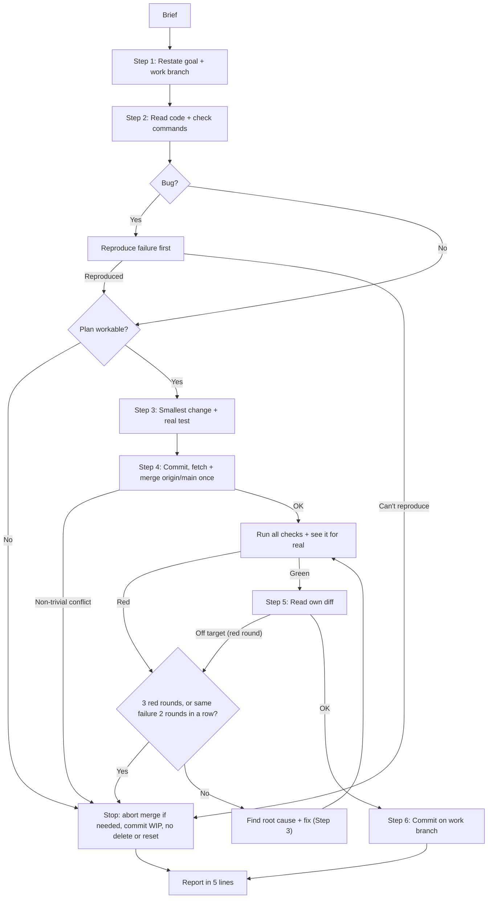

# jt

A lean coding-execution skill for AI agents — take a brief, verify for real, report back in 5 lines. (`v0.1.0`)

**jt** is a single Agent Skill ([`skills/jt/SKILL.md`](skills/jt/SKILL.md)) that follows the open `SKILL.md` standard. Give an agent a coding brief; it does the work on a work branch, checks the result against the real running program (locally or in dev), and reports back in 5 lines. The human-side orchestrator plans before (and hands over the brief), and handles review, PR/MR and merge after — `jt` owns only the execution step in between.

## Why

Coding agents tend to fail in the same five ways. `jt` counters each one with a concrete rule:

| Common agent failure | How `jt` prevents it |
| --- | --- |
| Claims "tests pass" without checking the real running program | Requires seeing real output (call the API, open the page, or run the program) — or stating why it could not be run |
| Loosens tests or checks to turn failures green | Forbids weakening tests/checks; changing an existing test expectation requires a reason in the report |
| Wanders outside the brief to refactor or "clean up" | Restricts work to one minimal change; out-of-brief findings are noted, never edited |
| Loops forever on a broken fix or unworkable plan | Stops after 3 failed rounds, 2 identical failures in a row, a non-trivial merge conflict, a bug it can't reproduce, or an unworkable plan — commits WIP instead of resetting |
| Reports vaguely ("done, looks good") | Enforces a fixed 5-line report: goal, what changed, what was observed, what was not run, and blockers/notes |

## The flow



1. **Restate the goal** in one sentence, define what "done" visibly looks like, and work on the task's work branch (not `main`; if the brief names none, create one).
2. **Read relevant code and check commands** from `AGENTS.md`, `README`, or `Makefile`. For bugs, reproduce the failure first (if it can't be reproduced, stop). If the brief's plan won't work, stop.
3. **Make the smallest change** for that single task and test real behavior.
4. **Verify for real:** merge `origin/main` once, the first time you reach this step (commit your work first, then fetch; not again on retry rounds; on a non-trivial conflict run `git merge --abort` and stop), then run all checks and observe real output locally/in dev (call the API, open the page, or run the program — "tests pass" alone does not count). On failure, find the root cause and return to step 3; stop after 3 red rounds or 2 identical failures in a row.
5. **Read your own diff:** verify it hits the goal, stays inside the brief, and genuinely tests the behavior; if not, return to step 3 (counts as a red round).
6. **Commit on the work branch** and send the 5-line report. If stopped at any step, abort any in-progress merge first, commit WIP on the work branch (never delete or reset), and send the same 5-line report with the blocker.

## Install

Clone once, then symlink `skills/jt` into your harness's skills directory. No plugin manifest is needed.

```bash
git clone https://github.com/thitinan147/jtek-skill.git ~/my-agent-skill/jtek-skill
```

| Harness | Command |
| --- | --- |
| Claude Code | `mkdir -p ~/.claude/skills && ln -sfn ~/my-agent-skill/jtek-skill/skills/jt ~/.claude/skills/jt` |
| Cursor | `mkdir -p ~/.cursor/skills && ln -sfn ~/my-agent-skill/jtek-skill/skills/jt ~/.cursor/skills/jt` |
| Grok Build | `mkdir -p ~/.grok/skills && ln -sfn ~/my-agent-skill/jtek-skill/skills/jt ~/.grok/skills/jt` |
| Antigravity (`agy` CLI, App, IDE) | `mkdir -p ~/.gemini/config/skills && ln -sfn ~/my-agent-skill/jtek-skill/skills/jt ~/.gemini/config/skills/jt` |

- **One link covers three harnesses:** Linking into `~/.claude/skills/jt` is enough for Claude Code, Cursor, and Grok Build, since Cursor and Grok Build also read `~/.claude/skills/`. Antigravity (`agy`) needs its own link in `~/.gemini/config/skills/jt`.
- **Per-project alternative:** Symlink into `.agents/skills/jt` (read by Cursor, Grok Build, and Antigravity) or `.claude/skills/jt` inside a project instead of your home directory.
- **Update:** Run `git -C ~/my-agent-skill/jtek-skill pull` — the symlink picks up changes automatically.
- **Uninstall:** Remove each symlink you created (e.g. `rm ~/.claude/skills/jt ~/.gemini/config/skills/jt`), and optionally remove `~/my-agent-skill/jtek-skill`.

## How to use

Type `/jt` followed by your brief, or just send a coding brief and let the agent pick `jt` from its description. `jt` writes its report in the language of your brief; the 5 labels stay in English.

**Example brief:**

```text
/jt Add a per-IP rate limit (5 requests/minute, return HTTP 429) to POST /login in acme-api.
Reuse the in-memory limiter helper in src/middleware/rateLimit.ts.
Work on branch feat/login-rate-limit.
```

**Example 5-line report:**

```text
- Goal: Limit POST /login to 5 requests/minute per IP and return HTTP 429 on excess requests.
- Did: src/routes/login.ts, tests/login.rateLimit.test.ts (commit 3a9f1c2 on feat/login-rate-limit).
- Saw: `npm test` (42/42 pass), `npm run typecheck` (pass); sent 6 curl calls to localhost:3000/login — calls 1-5 returned 401, call 6 returned 429 with Retry-After header.
- Not run: Multi-instance load test (in-memory store runs single-process locally).
- Blocked & out-of-brief: None blocked. Noted: POST /register has no rate limit yet (left untouched).
```

## What `jt` won't do

- **Weaken tests or checks** to make failures pass.
- **Change existing test expectations** without explaining the reason in the report.
- **Touch `.env`, secrets, or production data/systems.**
- **Merge into `main`, push to `main`, or force-push.**
- **Edit anything outside the brief** — out-of-brief findings are noted, not fixed.
- **Plan the work with you** — bring a brief; if the plan is unworkable, `jt` stops.
- **Open or merge PRs/MRs**, or **deploy** code.
- **Review itself as a substitute for human review** — its self-diff check catches obvious slips, not design or approval decisions.

## Repo layout

```text
.
├── skills/jt/SKILL.md   # The jt Agent Skill (~40 lines)
├── README.md            # This guide
└── LICENSE              # MIT license
```

## License

[MIT](LICENSE)
