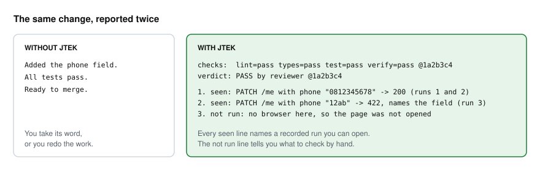
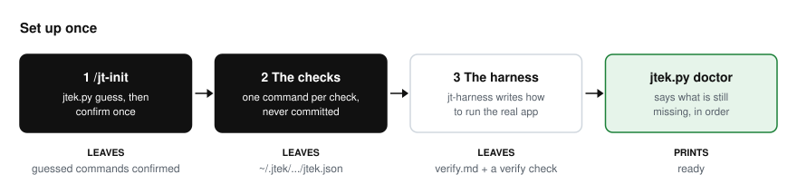
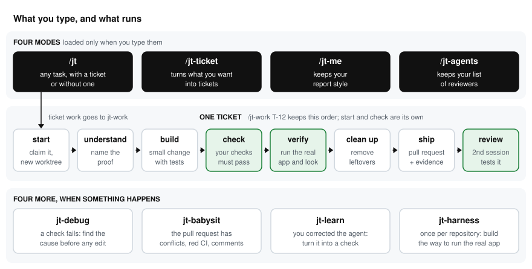

<h1 align="center">jtek</h1>

<p align="center">
  <em>One goal or ticket in. One pull request out. You merge.</em>
</p>

<p align="center">
  
  
  
  
  
</p>

<p align="center">
  <strong>New here?</strong> Start with the one-page <a href="GETTING-STARTED.md">Quickstart (GETTING-STARTED.md)</a>.
</p>

<p align="center">
  <picture>
    <source media="(prefers-color-scheme: dark)" srcset="assets/flow-dark.svg">
    
  </picture>
</p>

---

You know the pull request. Forty files. "All tests pass." The feature does not start.

An agent will tell you the work is done. jtek does not take its word. Work reaches Review only when the project's own checks pass on the current commit, a session that did not write the change has tried to break it, and the evidence says what was run and seen (or why it was not run) — one line per `Done when` item on ticket files, or for the goal as a whole on chat goals — plus `clean-up:`.

Then it stops. You read the evidence. You merge.

## Without it, with it

<p align="center">
  <picture>
    <source media="(prefers-color-scheme: dark)" srcset="assets/proof-dark.svg">
    
  </picture>
</p>

You ask for a phone number on the profile page. Without jtek you get three sentences and a diff. With jtek you get the checks that passed and on which commit, a verdict from a session that did not write the change, and one line per `Done when` item that says what was run and seen. Item 3 was not run, and the line says so: that is the one you open yourself.

## What you get back

Every session ends with the same block, whether you started it by hand or a script did.

```text
jtek-result
id: T-12
status: Review
outcome: review
waiting: -
checks: lint=pass types=pass test=pass verify=pass @1a2b3c4
verdict: PASS by reviewer @1a2b3c4
pr: https://github.com/you/app/pull/41
ci: pass
evidence: .git/jtek/work/T-12/evidence.md (2 seen, 1 not run, 2 of the seen cite a recorded run, clean-up rests on a recorded diff)
attention: -
branch: jtek/T-12
source: ~/.jtek/repos/github.com/you/app/tickets/T-12.md
note: the human reviews and merges; jtek never merges.
```

Read `evidence` first, then `attention`, then the diff. `attention` names files that decide whether checks pass: a changed check script, CI config, `.claude/`, a lockfile, `Makefile` or `package.json`, a deleted test, or an existing test that lost lines. It works from a list of known names. Add your project's own with `watch` in the machine config.

## How it works

1. **You start from a ticket file or a goal typed in chat.**
   - **Goal in chat:** type `/jt <goal>` (or `/jt-work <goal>`). The agent starts directly with `jtek.py start --local --goal "<goal>"` (assigning a local id such as `LOCAL-1` with no ticket file, no `Done when`, and no `broke` step) and proceeds unless the change reaches outside the pull request.
   - **Existing ticket file:** save a ticket file under `~/.jtek/repos/<repo id>/tickets/` with `jtek.py ticket <file> --save` (or write one directly), set `status: Todo`, and run `/jt-work T-12` (or `jtek.py start --from-file <file>`).
2. **A session claims it.** `jtek.py start` claims the ticket, creates a worktree under `.claude/worktrees/<id>`, runs `setup`, and runs the declared checks on the base first. If a check is already red on the base, `start` records it as `known-red`, saves one local Backlog follow-up ticket file, and continues.
3. **It works in steps.** Understand, build, check, see it work, clean up, ship. Each step is one small skill, and `jt-work` keeps the order.
4. **The project's checks run.** They come from the machine config, not from the worktree. An edit in the worktree cannot weaken them.
5. **A second session gives the verdict.** It did not write the change, and it reads only the ticket file (or the stored chat goal) and the diff. A verdict belongs to the content of the change, so any edit, even of whitespace, needs a new one. So does a change you make to the ticket.
6. **A pull request opens** with the evidence as its body (per `Done when` item for ticket files, or at least one `seen:`/`not run:` line plus `clean-up:` for chat goals). `finish` marks a draft pull request ready once both a passing verdict and green CI hold, and updates the ticket file's header directly (`status: Review` and `pr:`). If review comments, conflicts, or red CI arrive, `jt-babysit` handles them.
7. **You merge.** There is no merge command.

Inside the pull request the agent decides for itself: a new dependency, a migration file, or a change to CI goes ahead, and the result names it for you. It stops only before something that acts outside the pull request, such as a deploy or a change to real data, or when it is stuck. A decision that belongs in the pull request is not a stop: the agent chooses, writes it as a `choice:` line in the evidence, and goes on, so you see it and can change it at review. When it does stop, you answer in chat (for a `LOCAL-<n>` ticket) or in the ticket file and set `status: Todo` (or comment on the pull request).

## The whole factory

<p align="center">
  <picture>
    <source media="(prefers-color-scheme: dark)" srcset="assets/factory-dark.svg">
    
  </picture>
</p>

| Loop | Who | What it does | What it never does |
|---|---|---|---|
| **Human in the loop** | You | Gives a goal in chat or writes a ticket file, releases ticket files (`status: Todo`), answers questions, reads the evidence, merges | |
| **Outer loop** | You, a Claude Code session, or a script | Runs `jtek.py next` over local ticket files and claims, starts a session, runs `jtek.py sync` after merges | Writes code, gives a verdict, sets Todo, merges |
| **Inner loop** | One agent session per ticket | Builds the change in its own worktree, passes the checks, sees it work, opens the pull request. A second session gives the verdict | Picks the next ticket, merges |

jtek is the inner loop, plus the local file commands (`next`, `status`, `sync`) to drive it. Black boxes are yours. Green boxes run something real. Dashed lines are the ways back: a question for you, or a failed review.

## The prompt

The whole set is fifteen skills and one Python script: eleven steps, and four modes you type (`/jt`, `/jt-init`, `/jt-me`, `/jt-agents`). Start with [`skills/jt-work/SKILL.md`](skills/jt-work/SKILL.md): it is the router, and the only skill that knows the order. The script is [`skills/jt-work/scripts/jtek.py`](skills/jt-work/scripts/jtek.py), standard library only. Three small files beside it, `launcher.py`, `doctor.py`, and `agents.py`, hold the commands that are not part of working a ticket. `guess.py` is the read-only check guesser `/jt-init` uses.

It uses no other skill set.

## Install

**Any agent** (Claude Code, Cursor, Antigravity, Codex, ...) with [skills.sh](https://skills.sh/thitinan147/jtek-skill):

```bash
npx skills add thitinan147/jtek-skill
```

**Claude Code**, as two separate prompts:

```
/plugin marketplace add thitinan147/jtek-skill
```
```
/plugin install jtek@jtek-skill
```

Install the whole set. The script lives in `jt-work` and `jt-review`, so a step skill installed alone cannot run it. After that, day to day is `/jt`, `/jt-work`, and `/jt-review`. The first repository is `/jt-init`.

Needs `git` 2.31 or later and Python 3.10 or later. With GitHub you also need `gh`, signed in; with GitLab, `glab`, signed in: the agent opens a draft pull or merge request with it, and the script reads state, posts comments, and marks it ready once both PASS and green CI hold. With another forge, you can override state reading with `pr_state` in the machine config.

## Set up

<p align="center">
  <picture>
    <source media="(prefers-color-scheme: dark)" srcset="assets/setup-dark.svg">
    
  </picture>
</p>

One command, once per repository. From a blank machine through install, machine setup, repo init, and your first task, follow the one-page **[Quickstart (GETTING-STARTED.md)](GETTING-STARTED.md)**.

```text
/jt-init
```

`/jt-init` runs `jtek.py init` (or `jtek.py migrate` when the repository still has `jtek.json` or `.jtek/`, and then you commit that removal). It guesses each check from `package.json` scripts, the `Makefile`, `pyproject.toml`, and CI, shows the guesses, and asks once:

```text
checks? confirm or edit these commands
```

You can accept or edit any guessed command in that same answer. It writes `~/.jtek/repos/<repo id>/jtek.json` on this machine, runs the `jt-harness` skill, then `jtek.py doctor` until that prints `ready` or names what is still missing. Nothing is written into the repository.

```json
{"name": "web", "setup": "npm ci", "checks": {"lint": "npm run lint", "types": "npm run typecheck", "test": "npm test", "verify": "node scripts/verify.mjs"}}
```

A command is one program with arguments, so a pipeline goes into a script. Without the harness, a passing check only means the code compiles. A machine that has no guide, such as a fresh cloud agent, reads the README and the code and says so. `/jt` and `/jt-work` run this same flow themselves when the repository has no machine config yet, ask once, and then continue what you asked.

jtek adds no file to a repository. Config, the verify guide, the feature map, the rule table, and ticket files live under `~/.jtek`. A ticket that needs to update `verify.md`, `features/`, or `rules.md` writes whole-file overrides under `~/.jtek/repos/<repo id>/verify.d/<ticket id>/` (exposed via `JTEK_VERIFY_DIR` for that ticket's `check`, `broke`, and `run`, without affecting other tickets or approval stops), and `jtek.py sync` promotes them after merge or holds on a conflict. The repository id is the origin's host, non-default port, and path (`github.com/acme/widget`, or `gitlab.example:2222/acme/widget`). With no origin it is `path` plus the checkout path. `jtek.py migrate` moves a repository that still has `jtek.json` or `.jtek/` into that folder and tells you to commit the removal. The same command moves `~/.config/jtek/agents.json` and `~/.config/jtek/me.md` to `~/.jtek` and refuses to overwrite. The old path is still read, with a one-line notice, until then. Claims, logs, and results live under the git directory and are never committed. Details: [setup.md](skills/jt-work/references/setup.md).

## Commands

Day to day you type `/jt`, `/jt-work`, and `/jt-review`. Setup is `/jt-init`.

| You want to | Do this |
|---|---|
| Set up this repository | `/jt-init`, once. One confirmation covers the guessed `setup` and `checks` commands |
| Work from a chat goal | `/jt <what to do>` (or `/jt-work <what to do>`). Starts directly with `start --local --goal` (`LOCAL-<n>`, no ticket file, no `Done when`, no `broke`), with the same checks, evidence, and second-session review |
| Save a ticket file for later | Draft a five-slot ticket file and run `jtek.py ticket <file> --save` (saves Backlog under `~/.jtek/repos/<repo id>/tickets/T-<n>.md`); set `status: Todo` in the file to release it. See [files.md](skills/jt-work/references/files.md) |
| Work a ticket file | `/jt-work T-12` or `/jt-work <path/to/ticket.md>` (or `/jt T-12`) |
| Work a few small, related tickets | `/jt-work T-12 T-13 T-14` |
| Give the verdict a ticket needs | `/jt-review T-12` (or `/jt-review LOCAL-1`) in a fresh session |
| Check readiness and open tickets | `jtek.py status` (read-only readiness + Thai summary table) or `jtek.py next` (tab-separated next actions) |
| Mark merged PRs Done and tidy worktrees | `jtek.py sync` |
| Answer a question, or ask for a fix | Reply in chat (for `LOCAL-<n>`, resumed with `start --local <id> --answered`), edit the ticket file and set `status: Todo`, or submit a PR review |
| Give a ticket back, or clean up an interrupted start | Run `jtek.py release T-12`. A branch that holds work is kept, and the next start goes on from it |
| Let a script or session start sessions | [starting-sessions.md](skills/jt-work/references/starting-sessions.md) |

## Skills

<p align="center">
  <picture>
    <source media="(prefers-color-scheme: dark)" srcset="assets/skills-dark.svg">
    
  </picture>
</p>

Black boxes are what you type. Green boxes run something real. `start` and `check` are `jt-work` and its script; every other box is a skill of its own, fifteen with `jt-work`. The table has each by name:

| Step | Skill | What it does |
|---|---|---|
| Set up a repository | `jt-init` | Typed as `/jt-init` only. Guesses the checks, asks once to confirm or edit them, records the machine config, runs the harness, then doctor. An old `jtek.json` or `.jtek/` is migrated instead, and you commit the removal |
| Your reviewers | `jt-agents` | Typed as `/jt-agents` only. Surveys the coding agents on your machine with `jtek.py doctor --agents` and proposes your ordered list of reviewers, `~/.jtek/agents.json`, which you accept or not |
| Your style | `jt-me` | Typed as `/jt-me` only. Reads how you have really worked and proposes changes to your style file, `~/.jtek/me.md`, which you accept or not |
| Your mode | `jt` | Typed as `/jt` only. Routes ticket files and chat goals directly to `jt-work` (chat goals run under `LOCAL-<n>` with no ticket file or `Done when`), and reports in your style with the principle behind each decision |
| Start, check, stop | `jt-work` | Claims the ticket, creates the worktree, runs the declared checks, and keeps the order of the steps in a playbook for a feature, a bug, or a refactor |
| Understand | `jt-understand` | Reads the ticket and the code, and names how each `Done when` item will be seen working |
| Build | `jt-build` | Makes the smallest change with tests, reusing what the codebase already has |
| A check fails | `jt-debug` | Finds the cause before changing code, and stops after three failed runs, or the number the project set |
| See it work | `jt-verify` | Runs the real thing and reports only what was seen |
| Clean up | `jt-cleanup` | Removes debug output, unused code, and comments that repeat the code |
| Ship | `jt-ship` | Opens the pull request with the proof for each item, and moves the ticket to Review |
| Second look | `jt-review` | A session that did not write the change reads the ticket file (or stored chat goal) and diff, tries to break it, and records the verdict |
| The pull request needs work | `jt-babysit` | Clears conflicts, failing CI, and review comments, and never merges |
| After a correction | `jt-learn` | Turns a repeated mistake into a type, a lint rule, a fix to old examples, or a new check, and keeps a small rule table |
| Once per repository | `jt-harness` | Builds the way to run and observe the real app: a verify guide, a feature map, and the `verify` check |

## Your mode: `/jt`

`/jt` is a mode, not a step: it loads only when you type it. Type `/jt` and then a ticket id, a ticket file, or what you want done:

- From a chat goal, the agent starts directly with `jtek.py start --local --goal "<goal>"` (giving it an id such as `LOCAL-3`) and proceeds unless the change reaches outside the pull request. No ticket file, no `Done when`, and `broke` is skipped (`broke` applies per `Done when` item on ticket files only).
- The script stores the goal in the claim folder for the reviewer to read, creates a worktree, runs every declared check, and requires evidence (`seen:`/`not run:` and `clean-up:`). Only you give it new tries via `jtek.py release`.
- A local change of one file, with nothing on the `attention:` line, skips the second look, and the result says so. Anything bigger needs a verdict, as a ticket file does.
- It pushes and opens a pull request. It never merges.

Every agent a session starts reads [worker.md](skills/jt-work/worker.md) first: the rules it keeps whatever its prompt says. The principles the steps apply have ids, in [principles.md](skills/jt-work/references/principles.md), and the evidence and the report name the id behind each decision.

Your own style lives outside this repository, in `~/.jtek/me.md`: the language of the report, how short, and anything else that is yours. `/jt` reads it when it exists, and so do `jt-work`, `jt-ship`, `jt-review`, and every helper they start; the line prefixes the script reads, such as `seen:` and `choice:`, stay in English. An old `~/.config/jtek/me.md` is still read, with a one-line notice, until `jtek.py migrate` moves it. `/jt-me` proposes changes from how you have really worked, which you accept or not. It sets style only; it cannot change a rule of jtek. For example:

```markdown
- Report in Thai. Short, with tables. The result first, then what I must decide.
```

## Who gives the second look

<p align="center">
  <picture>
    <source media="(prefers-color-scheme: dark)" srcset="assets/reviewer-dark.svg">
    
  </picture>
</p>

A reviewer from another vendor than the author's is preferred, because two models of one family tend to miss the same thing. That is a reason, not a measurement: no eval here compares the two yet.

| You want to | Do this |
|---|---|
| See which agents this machine has | Ask the agent to run `jtek.py doctor --agents`. It needs no repository. It lists the models of a program that can list them, which today is `cursor-agent`; for the others you name the model yourself |
| Make or update your list | Type `/jt-agents`. It runs the survey, asks which models you trust and in what order, and writes the file after your yes |
| Know who would review now | `jtek.py reviewer --vendor <the author's vendor>`, for example `--vendor anthropic` |

The list is `~/.jtek/agents.json`, outside every repository. `jtek.py migrate` moves `~/.config/jtek/agents.json` there and refuses to overwrite a file that is already in the new place:

```json
{"reviewers": [
  {"command": "codex exec -m <model>", "vendor": "openai", "model": "<model>"},
  {"command": "cursor-agent -p --model <model>", "vendor": "xai", "model": "<model>"}
]}
```

Put only models you trust to review on it: the script follows your order and does not rank models. `vendor` is who made the model, so an agent that serves several vendors has one entry per model. Without a list, the reviewer is a fresh session of the author's own model, as before. When the list exists, `verdict` accepts only names from it; the script still cannot prove which model answered, so `--by` on the verdict remains a label, as [SECURITY.md](SECURITY.md) says.

## Templates

Three files carry a task from your head to your review. Each has a form, and each form is short.

**The ticket file**, when you work from a saved ticket:

```markdown
## Goal
A user can add a phone number on the profile page, so that sales can call back.

## Done when
- PATCH /me with a 10-digit `phone` returns 200, and GET /me returns the same number
- a `phone` that is not 10 digits returns 422 and names the field
- the profile page shows the saved number after a reload

## Out of scope
- the response for every other field of /me stays the same, byte for byte
- no SMS confirmation yet
```

Every `Done when` item names an input and a result, so someone can see it work. `Out of scope` names behaviour that must not change.

**The evidence**, which the agent writes and you read before the diff. One numbered line per `Done when` item (or at least one `seen:`/`not run:` line for a chat goal) and a `clean-up:` line, and the script refuses a file that lacks either:

```text
The profile now stores a phone number. PATCH /me validates it with the existing validator, and the page shows it.

1. seen: PATCH /me with phone "0812345678" on the local server -> 200, then GET /me returns "0812345678" (runs 1 and 2)
2. seen: PATCH /me with phone "12ab" -> 422 {"field":"phone","error":"must be 10 digits"} (run 3)
3. not run: no browser on this machine, so the profile page was not opened. The API returns the value

Notes:
- clean-up: removed a console.log left in the handler (run 4)
- reused the validator in lib/validate.ts
- the number is stored as text, because a leading 0 is lost in a number
```

`seen:` means it was run and looked at, and `(run 3)` names the run `jtek.py run` recorded, which a reader can open. `not run:` is an honest answer, and it tells you what to check by hand. Here that is item 3.

<details>
<summary><strong>The review notes</strong>, which the second session writes</summary>

A finding has steps that fail when anyone runs them:

```markdown
Findings:
- reproduces: PATCH /me with an empty phone returns 500, not 422
  steps: start the server as the verify guide says, then PATCH /me with phone ""
  expected: 422, by Done when item 2

Notes:
- did not reproduce: a phone with spaces. Tried "081 234 5678", got 422 as it should
- the new tests cover items 1 and 2. Nothing tests item 3
- broke: the length check in lib/validate.ts; the test check failed, so the test is real
- safe because: the validator already guards the signup form, and its tests pass unchanged (run 4)
```

</details>

<details>
<summary><strong>This machine's files:</strong> <code>~/.jtek/repos/&lt;repo id&gt;/jtek.json</code>, <code>verify.md</code>, a feature file, and <code>rules.md</code></summary>

`jtek.json`, under `~/.jtek/repos/<repo id>/`. One command per check, read from there and never from a ticket's worktree:

```json
{"name": "web", "setup": "npm ci", "checks": {"lint": "npm run lint", "types": "npm run typecheck", "test": "npm test", "verify": "node scripts/verify.mjs"}}
```

`~/.jtek/repos/<repo id>/verify.md`, written by `jt-harness`. How an agent starts the real app and checks it:

```markdown
## Launch
- Install: `npm ci`
- Port: 3000 plus the ticket's number, so two worktrees never share one. Ticket `T-12` uses 3012.
- Start: `npm run dev -- --port <port>`
- Ready when: `node scripts/ready.mjs <port>` exits 0. A listening port is not ready yet.

## Doctor
1. Port in use: another worktree is running. Take the port from the ticket's number as above.
2. `ECONNREFUSED :5432`: the database is not up. Run `docker compose up -d db`.

## Drive
- API: `node scripts/api.mjs <port> GET /me` prints the status and the body.
- Screen: open `/profile`, find the field by its label "Phone", type, and press the button named "Save".

## Evidence
- A command: the command, its output, and the exit code.
- A write: read the stored value back with a second, read-only call.

## Cleanup
- Stop the server you started. `npm run db:reset` removes the rows the run created.
```

`~/.jtek/repos/<repo id>/features/profile.md`, one file per main feature:

```markdown
## How a user gets to it
Log in, then the avatar menu, then "Profile". Direct link: `/profile`.

## How to drive it
1. `node scripts/api.mjs <port> GET /me` shows the current values.
2. `node scripts/api.mjs <port> PATCH /me name=New` changes one.

## What to observe
- PATCH returns 200 and the changed field. A second GET returns the new value.

## Gotchas
- The page caches `/me` for 30 seconds. Reload with the cache off.
```

`~/.jtek/repos/<repo id>/rules.md`, kept by `jt-learn`. A rule goes in after a mistake happened twice, and each row names what enforces it:

```markdown
| Rule | Enforced by | Since | Why |
|---|---|---|---|
| Money is an integer number of cents | type `Cents` in `lib/money.ts` | 2026-03-02 | A rounding bug shipped twice |
| Every endpoint checks the caller's tenant | test helper `forEachRoute` | 2026-04-11 | A ticket added a route with no check |
| Do not mock the database in integration tests | prose | 2026-06-01 | To replace: a lint rule on `jest.mock('db')` |
```

These forms are starting points, used so far on demo repositories only. They live on the machine, not in the repository.

</details>

The full forms, with the rules each one stands for:

| For | File | Who fills it in |
|---|---|---|
| A ticket file | [ticket-template.md](skills/jt-work/references/ticket-template.md) | You (or `jtek.py ticket --save`) |
| `jtek.json` for Node, Python, and Go | [setup.md](skills/jt-work/references/setup.md) | You, once per repository |
| The evidence | [evidence.md](skills/jt-ship/references/evidence.md) | The agent |
| The review notes | [notes.md](skills/jt-review/references/notes.md) | The reviewing session |
| `verify.md` and a feature file | [verify-template.md](skills/jt-harness/references/verify-template.md) | `jt-harness` |
| `rules.md` | [rules-template.md](skills/jt-learn/references/rules-template.md) | `jt-learn` |

## Fit it to your project

The rules are fixed. The numbers and names around them are yours, in `jtek.json`:

| Key | What it changes | Default |
|---|---|---|
| `checks`, `setup` | The commands that decide "passing", in any language or build system | none: you declare them |
| `max_failed_runs` | How many failed check runs end a session. Raise it for a model that often finds the cause on a later try | 3 |
| `pr_state` | Optional override command that reads a pull request's state, for another forge or a custom reader (`gh` for GitHub and `glab` for GitLab are built in) | built-in `gh` / `glab` |
| `headings` | The names of the ticket headings, in your team's language | `Goal`, `Done when`, `Out of scope` |
| `watch` | More files that the `attention:` line should name | a list of common names |
| `forge` | `"gh"` or `"glab"` to override auto-detection, or `false` when the remote is not a forge so tickets end without a pull request | auto (`gh` / `glab`) |
| `name` | What tickets call this repository | the folder name |

Details: [setup.md](skills/jt-work/references/setup.md).

**What jtek does not decide.** How the agent writes the code, which tools it uses, how it splits the work inside a ticket, and how good the model is. The script looks at results: the checks, the broke record (for ticket files), the evidence, the verdict. A better model reaches them sooner, and nothing here is in its way.

<details>
<summary><strong>Which agent, which model, and where it does not fit yet</strong></summary>

**Which agent.** The same tickets were worked end to end on Claude Code, on Cursor's command-line agent (its own pick of model, with a Grok reviewer), and on Antigravity's (Gemini). All three read the skill files, recorded their runs with `jtek.py run`, and started their own reviewer.

**Which model.** Use the strongest model you have for `jt-work`, and above all for `jt-review`. On the same tickets, Sonnet and Haiku got the code right, but each wrote a `seen:` line that said more than it had run and skipped part of a step; the strongest model did that once in nine rounds. The script holds what a machine can check, and a run recorded with `jtek.py run` shows what a `seen:` line rests on. Whether the line matches the run is still for the reviewer to read, so a smaller worker needs a reviewer on the strongest model.

**What still assumes today's agents.** Tickets small enough for one pull request, one ticket at a time in a session, and stopping to ask only when a step reaches outside the pull request or gets stuck. The step skills also teach a method for debugging and building; the playbook's order is a default, and an agent may combine or reorder steps as long as what the script and the reviewer check still holds. Run the [evals](evals/README.md) when you change models, including the lean build without the step skills, and cut the text that no longer raises the score.

**Where it does not fit yet.**

- A project whose real behaviour cannot be run from a command line, such as some mobile apps, games, and hardware. The checks still work. The `verify` step has little to run.
- Windows. Nothing has been tested there.
- A project without git, or one where a second worktree cannot be set up by a command.

</details>

## Statuses

`jtek.py` tracks these `status:` values in local ticket files for bookkeeping (`after:` waits for `Done`, `start` requires `Todo`, `sync` marks merged PRs `Done`):

| Status | Meaning | Who sets it |
|---|---|---|
| Backlog | Written down, not released | `jtek.py ticket --save`, or you |
| Todo | Released for an agent | You only |
| In Progress | A session has claimed it | `jtek.py start` |
| Review | Checks pass, verdict is PASS, evidence saved, pull request open (or the repository has no forge) | `jtek.py finish` |
| Done | Pull request merged | `jtek.py sync` from the forge (or you without a forge) |
| Cancelled | Dropped | You |

Waiting, with `input` or `approval`, is a header field of an In Progress ticket file. It is not a status. The ticket format and the result block are in [ticket.md](skills/jt-work/references/ticket.md).

## Not proven yet

No benchmark numbers here. There are none to show yet. What exists is a count of what was tested and walked:

| What | How far |
|---|---|
| **Tested** | The script, by the unit test suite (`python3 -m unittest discover -s tests`), and four outside reviews whose findings are fixed and tested |
| **Walked** | 39 tickets walked to Done across demo repositories over twenty rounds with fresh agent sessions (features, bugs, refactors, two-repo pairs, squash merges, rework, FAIL verdicts, parallel worktrees) |
| **Not proven** | A large real codebase, GitLab, Windows, a pull request whose own CI goes red, and the reviewer list with a real reviewer |

Use it by hand, one task at a time, before you let any script start sessions for you.

## FAQ

**Does it merge?**
No. There is no command for it.

**Can the agent mark its own work as done?**
It can say so. The script wants the checks, the evidence, and a verdict for the current content of the change.

**Can the agent weaken a check to pass?**
Not by editing `jtek.json`: the script reads it from the machine config under `~/.jtek`. What a check runs is read from the worktree, so a ticket can change it. The result names such a file on the `attention:` line when it is a known name or on your `watch` list, and that ticket cannot waive the review. A file the list does not know is not named.

**Can it give the verdict on its own change?**
`start` records the session, and `verdict` refuses that same session. Set `JTEK_SESSION` to one id for the writing session and a different id for the reviewer. The same text in `CURSOR_SESSION_ID` is the same session. Without one of those ids, `start` and `verdict` refuse. The parent process is not a session. An agent that changes `JTEK_SESSION` for the verdict can still bypass this. Do not put `verdict` on an always-allow list in the session that writes code. See [SECURITY.md](SECURITY.md).

**Do I need the second session for a one-line fix?**
A one-file `--local` change with nothing on `attention:` skips the second look automatically. For a saved ticket file, set `review: human` on that ticket; the waiver is ignored when the change touches a file on the `attention:` line.

**Two repositories, one feature?**
Two ticket files, joined by a contract file and a check on each side. [two-repos.md](skills/jt-work/references/two-repos.md).

**Does it hold back a stronger model?**
The rules check results, not method. The one number that could, the limit on failed check runs, is yours to set. See [Fit it to your project](#fit-it-to-your-project).

**GitLab? A ticket in Thai?**
Yes to both: `glab` is built in for GitLab (with `forge` or `pr_state` as overrides), and `headings` in the machine config sets the ticket headings.

**Is this a software factory?**
It is the part inside one session, plus local file bookkeeping. What starts the next session is up to you.

## Coming from earlier versions

See [CHANGELOG.md](CHANGELOG.md) for the full history, including the v26 rewrite (old v25 set at commit `4c9d0f1`), the v27 move of config and knowledge out of repositories onto `~/.jtek`, the v29 removal of external trackers, and the v30 simplification of chat goals (direct `--local --goal` runs with no ticket file or `Done when`).

## Acknowledgements

The `/jt` mode, the chat-goal intake, the rules every started agent reads first in `worker.md`, and the PASS, PASS+NOTES, and FAIL verdicts follow the shape of pstack by Lauren Tan ([cursor/plugins](https://github.com/cursor/plugins/tree/main/pstack), MIT). jtek differs where it matters: a script holds the results, and only the human merges.

## License

[MIT](LICENSE).
